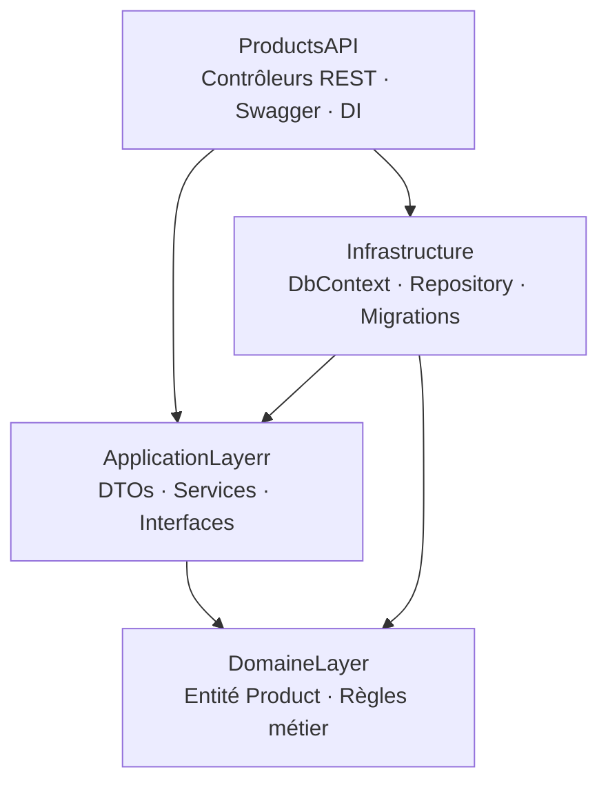

# CleanArch — API Products


API REST de gestion de produits écrite en **ASP.NET Core (.NET 10)** et organisée selon les
principes de la **Clean Architecture**. Le projet montre la séparation en quatre couches, la
persistance avec **Entity Framework Core** et **MySQL**, la documentation automatique avec
**Swagger** et la validation des règles métier dans le domaine.

---

## Sommaire

- [Architecture](#architecture)
- [Stack technique](#stack-technique)
- [Structure du dépôt](#structure-du-dépôt)
- [Prérequis](#prérequis)
- [Configuration](#configuration)
- [Lancer le projet](#lancer-le-projet)
- [Migrations EF Core](#migrations-ef-core)
- [Endpoints de l'API](#endpoints-de-lapi)
- [Exemples d'appels](#exemples-dappels)
- [Règles métier et validation](#règles-métier-et-validation)
- [Données de démonstration](#données-de-démonstration)
- [Auteur](#auteur)

---

## Architecture

Le projet applique la règle de dépendance de la Clean Architecture : les couches internes ne
connaissent jamais les couches externes.



| Couche | Projet | Responsabilité |
|---|---|---|
| Domaine | `DomaineLayer` | Entité `Product`, validation des règles métier. Aucune dépendance externe. |
| Application | `ApplicationLayerr` | DTOs (`ProductDTO`, `CreateProductDTO`, `UpdateProductDTO`), interfaces et `ProductService`. |
| Infrastructure | `Infrastructure` | `ApplicationDbContext`, `ProductRepository`, migrations EF Core, configuration MySQL. |
| Présentation | `ProductsAPI` | `ProductController`, injection de dépendances, Swagger, `appsettings.json`. |

Le flux d'une requête : `ProductController` → `IProductService` → `IProductRepository` →
`ApplicationDbContext` → MySQL. Les entités du domaine ne sortent jamais de l'application :
elles sont converties en DTOs par `ProductService`.

---

## Stack technique

| Élément | Version / choix |
|---|---|
| Runtime | .NET 10 (`net10.0`) |
| API | ASP.NET Core Web API |
| ORM | Entity Framework Core 9.0 |
| Provider MySQL | `Pomelo.EntityFrameworkCore.MySql` 9.0 |
| Base de données | MySQL 8.x (XAMPP ou serveur local, port `3306`) |
| Documentation | Swagger / OpenAPI (`Swashbuckle.AspNetCore` 10.3) |
| Validation | DataAnnotations + règles métier du domaine |

---

## Structure du dépôt

```text
CleanArch/
├── CleanArch.slnx                  # Solution .NET
├── ApplicationLayerr/
│   ├── DTOs/
│   │   ├── ProductDTO.cs
│   │   ├── CreateProductDTO.cs
│   │   └── UpdateProductDTO.cs
│   └── Interfaces/
│       ├── Repositories/IProductRepository.cs
│       └── Services/
│           ├── IProductService.cs
│           └── ProductService.cs
├── DomaineLayer/
│   └── Entities/Product.cs
├── Infrastructure/
│   ├── Data/ApplicationDbContext.cs
│   ├── Repositories/ProductRepository.cs
│   └── Migrations/
└── ProductsAPI/
    ├── Controllers/ProductController.cs
    ├── Properties/launchSettings.json
    ├── appsettings.json
    └── Program.cs
```

---

## Prérequis

- [.NET SDK 10](https://dotnet.microsoft.com/download)
- Un serveur **MySQL** accessible (XAMPP, MySQL Installer, Docker…)
- Facultatif : `dotnet-ef` pour gérer les migrations

```powershell
dotnet tool install --global dotnet-ef
```

---

## Configuration

La chaîne de connexion se trouve dans `ProductsAPI/appsettings.json` :

```json
{
  "ConnectionStrings": {
    "DefaultConnection": "Server=localhost;Port=3306;Database=ProductManagementDB;User=root;Password=;"
  }
}
```

Adapte `User` et `Password` à ton installation MySQL. La base `ProductManagementDB` est créée
par les migrations EF Core.

---

## Lancer le projet

```powershell
# 1. Restaurer les dépendances
dotnet restore

# 2. Appliquer les migrations (crée la base et les tables)
dotnet ef database update --project Infrastructure --startup-project ProductsAPI

# 3. Démarrer l'API
dotnet run --project ProductsAPI
```

L'API écoute sur `http://localhost:5285` (profil `http`) et
`https://localhost:7019` (profil `https`). En mode `Development`, Swagger est disponible sur :

```text
http://localhost:5285/swagger
```

---

## Migrations EF Core

```powershell
# Ajouter une migration après une modification du modèle
dotnet ef migrations add NomDeLaMigration --project Infrastructure --startup-project ProductsAPI

# Appliquer les migrations en attente
dotnet ef database update --project Infrastructure --startup-project ProductsAPI

# Revenir à une migration précédente
dotnet ef database update NomDeLaMigration --project Infrastructure --startup-project ProductsAPI
```

---

## Endpoints de l'API

Base : `/api/Product`

| Méthode | Route | Description | Réponse |
|---|---|---|---|
| `GET` | `/api/Product` | Liste de tous les produits | `200 OK` + tableau de `ProductDTO` |
| `GET` | `/api/Product/{id}` | Détail d'un produit | `200 OK` ou `404 Not Found` |
| `POST` | `/api/Product` | Crée un produit | `200 OK` + `ProductDTO` créé |
| `PUT` | `/api/Product/{id}` | Met à jour un produit (l'`id` est aussi dans le corps) | `204 No Content` |
| `DELETE` | `/api/Product/{id}` | Supprime un produit | `204 No Content` |

Modèle `ProductDTO` renvoyé :

```json
{
  "id": 1,
  "name": "Laptop",
  "description": "High-end gaming laptop",
  "price": 1500.00,
  "stock": 10
}
```

---

## Exemples d'appels

### Créer un produit

```powershell
curl -X POST http://localhost:5285/api/Product `
  -H "Content-Type: application/json" `
  -d '{"name":"Clavier mécanique","description":"Switch rouge","price":89.90,"stock":15}'
```

### Lire les produits

```powershell
curl http://localhost:5285/api/Product
curl http://localhost:5285/api/Product/2
```

### Mettre à jour un produit

```powershell
curl -X PUT http://localhost:5285/api/Product/2 `
  -H "Content-Type: application/json" `
  -d '{"id":2,"name":"Smartphone","description":"Dernier modèle","price":750.00,"stock":20}'
```

### Supprimer un produit

```powershell
curl -X DELETE http://localhost:5285/api/Product/3
```

---

## Règles métier et validation

La validation est assurée à deux niveaux.

**DataAnnotations** dans les DTOs :

- `Name` : obligatoire, 100 caractères maximum ;
- `Price` : entre `0.01` et `1 000 000` ;
- `Stock` : jamais négatif.

**Règles du domaine** dans `Product.ValidateBusinessRules()` :

- le prix doit être strictement positif ;
- le stock ne peut pas être négatif.

Ces règles sont appelées par `ProductService` avant toute création ou mise à jour, ce qui
garantit qu'aucune donnée invalide n'atteint la base.

---

## Données de démonstration

La méthode `OnModelCreating` insère trois produits au premier `database update` :

| Id | Nom | Prix | Stock |
|---|---|---|---|
| 1 | Laptop | 1 500,00 € | 10 |
| 2 | Smartphone | 800,00 € | 25 |
| 3 | Wireless Headphones | 200,00 € | 40 |

---

## Auteur

**Alaa Chaabouni** — [@Ala012](https://github.com/Ala012)
